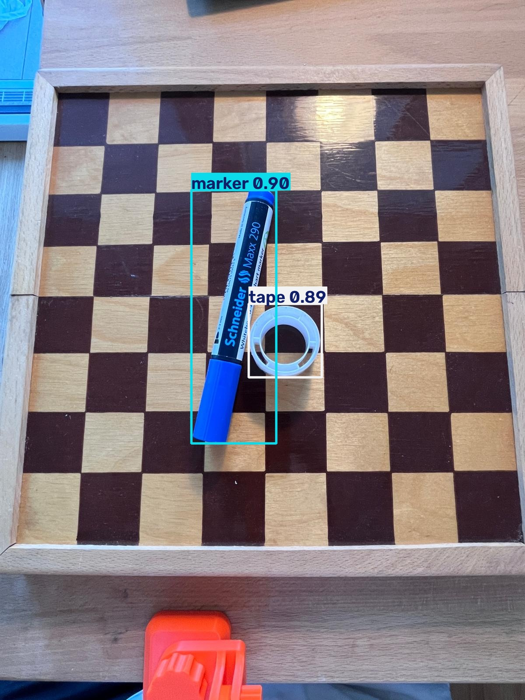
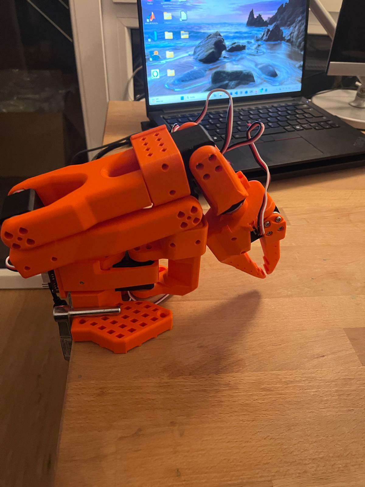
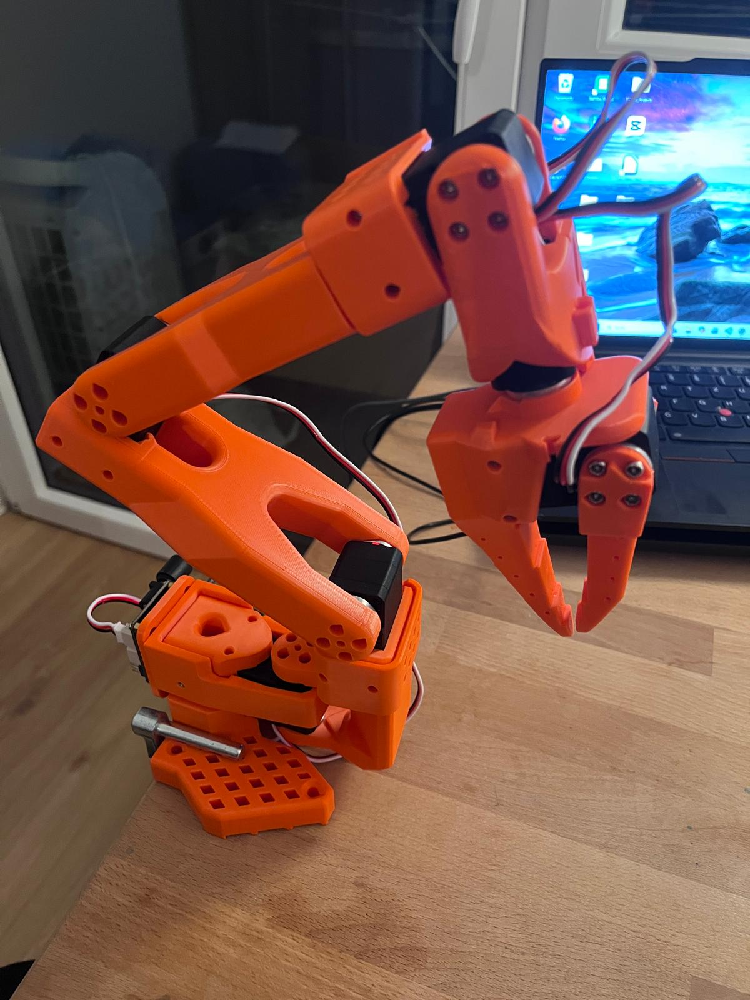
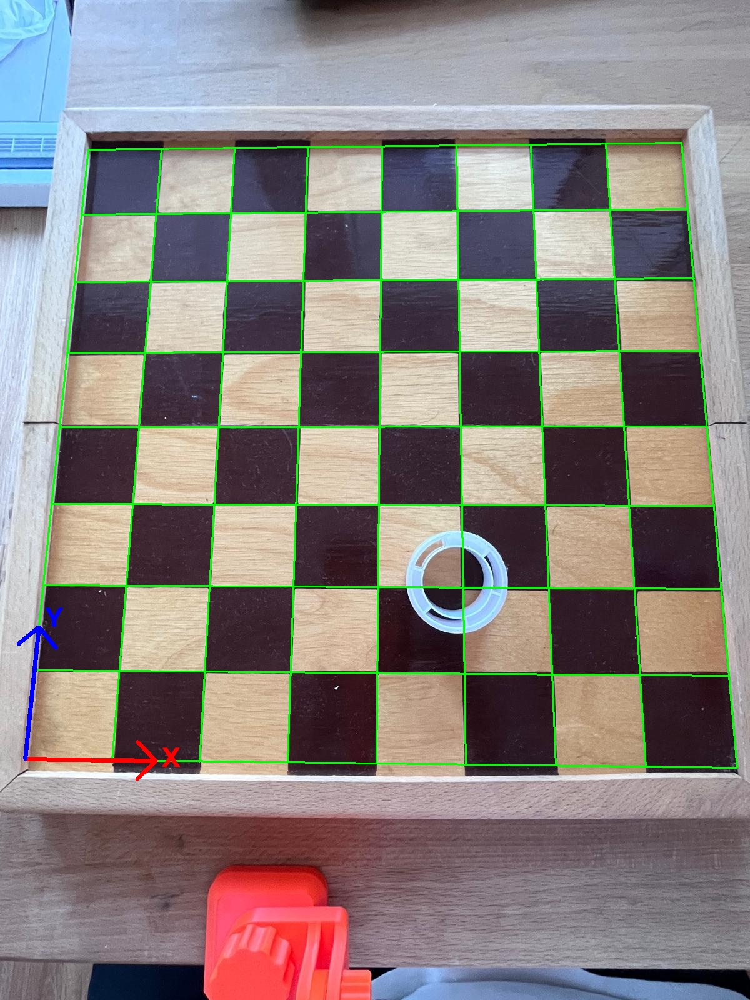

# LeRobot SO-101: Objekterkennung für einen Roboterarm

Vision-Pipeline für den Low-Cost-Roboterarm **SO-101** ([LeRobot](https://github.com/huggingface/lerobot)):
Eine Kamera über einem Schachbrett erkennt Objekte mit **YOLO** und rechnet ihre Position per
**Homographie** von Pixeln in Brett-Koordinaten um. Darauf baut später das Greifen mit dem Arm auf.



```
Fotos → Annotation (Roboflow) → Training (YOLO26n, CPU) → Erkennung → Pixel → Brett-Koordinaten → Roboter (geplant)
```

## Stand

| Schritt | Status |
|---|---|
| Datensatz aufnehmen und annotieren | ✅ 71 Bilder, 4 Klassen |
| Objekterkennung trainieren | ✅ Test mAP50-95 = 0,82 |
| Pixel → Brett-Koordinaten | ✅ Reprojektionsfehler 1,5 px |
| Servos einrichten und Arm kalibrieren | ✅ Follower-Arm |
| Brett → Roboter-Koordinaten | ⏳ |
| Greifen mit dem SO-101 | ⏳ |

## Hardware

SO-101 Follower-Arm mit 6 Feetech-STS3215-Servos (5 Gelenke + Greifer). Die Servos sind mit LeRobot
eingerichtet (IDs 1–6) und kalibriert.

<p>
  
  
</p>

## Datensatz

- 72 Fotos von oben aufgenommen, 71 in Roboflow annotiert ([`so101-vision/data/`](so101-vision/data/))
- Klassen: `clipper`, `marker`, `tape`, `tweezer`. **Zielobjekte** sind `marker` und `tape`, die anderen dienen als Störobjekte.
- Aufteilung: 53 Bilder Training / 9 Validierung / 9 Test, im YOLO-Format

## Objekterkennung

Transfer Learning mit einem vortrainierten **YOLO26n** (Ultralytics), komplett auf der CPU
(AMD Ryzen 5 7535HS, ca. 30 min für 100 Epochen).

| Klasse | mAP50 | mAP50-95 |
|---|---|---|
| marker | 0,995 | 0,835 |
| tape | 0,995 | 0,856 |
| clipper | 0,995 | 0,796 |
| tweezer | 0,995 | 0,796 |
| **gesamt** | **0,995** | **0,821** |

*Test-Split, 9 Bilder / 15 Objekte. Bei so wenigen Objekten sind die Werte als Tendenz zu lesen.*

**Was die Ergebnisse verbessert hat**

| Änderung | Effekt |
|---|---|
| Rotation in der Augmentation abgeschaltet (`degrees=10 → 0`). Bei langen, dünnen Objekten bläht Rotation die achsenparallelen Boxen auf. | Marker mAP50-95: **0,40 → 0,77** |
| Klasse `spoon` entfernt: nur 1 Beispiel, im Train-Split gar keins. Das deckelte den Validierungswert und verfälschte die Auswahl von `best.pt`. | saubere Modellauswahl |
| 4 falsch annotierte Bilder gefunden (Tape als „marker“ gelabelt) und korrigiert | Tape in diesen Bildern wird jetzt richtig erkannt (vorher als Marker oder gar nicht) |

Das lokale Modell wurde auf demselben Test-Split gegen ein in der Roboflow-Cloud trainiertes Modell verglichen.
Beim Marker erreicht es mAP50-95 0,84 gegenüber 0,66.

## Pixel → Brett-Koordinaten

[`calibrate_board.py`](so101-vision/calibrate_board.py) findet die 7×7 inneren Ecken des Schachbretts.
Daraus berechnet es eine Homographie, die jeden Bildpunkt auf die Brettebene abbildet und dabei auch die Perspektive ausgleicht.
Brett-Koordinaten werden in Schachfeldern angegeben. Der Ursprung ist die Ecke auf der Roboterseite.



Das Notebook [`board_calibration.ipynb`](so101-vision/notebooks/board_calibration.ipynb) erklärt die Methode
Schritt für Schritt, inklusive Vogelperspektive.

## Nutzung

```bash
cd so101-vision
python -m venv .venv
.venv\Scripts\pip install -r requirements.txt     # Windows

# Training (Ergebnis in runs/)
.venv\Scripts\python.exe train.py --name mein_lauf

# Brett einmalig kalibrieren (Kamera danach nicht mehr bewegen)
.venv\Scripts\python.exe calibrate_board.py data/raw/img_007.jpg --square-mm <Feldgröße>

# Erkennung auf Bild oder Webcam
.venv\Scripts\python.exe predict.py data/raw/img_041.jpg --all
.venv\Scripts\python.exe predict.py 0
```

Beispielausgabe:
```
img_041.jpg
  marker   conf=0.90  center=(534, 724) px  size=194x578  board=(3.44, 3.66) Felder
  tape     conf=0.89  center=(652, 778) px  size=167x168  board=(4.34, 3.23) Felder
```

## Struktur

```
so101-vision/
├── train.py                 Training (YOLO26n, Augmentation, Test-Auswertung)
├── predict.py               Erkennung + Umrechnung in Brett-Koordinaten
├── calibrate_board.py       Homographie aus dem Schachbrett
├── configs/                 Datensatz-Config, gespeicherte Kalibrierung
├── data/raw/                Originalfotos
├── data/labeled/            annotierter Datensatz (YOLO-Format)
├── notebooks/               Erklär-Notebook zur Kalibrierung
└── runs/yolo26n_4cls_fixed/ finales Modell (weights/best.pt)
```

## Tools

Python 3.11 · Ultralytics YOLO26 · PyTorch · OpenCV · Roboflow · Jupyter · Claude Code (KI-gestützte Entwicklung)
